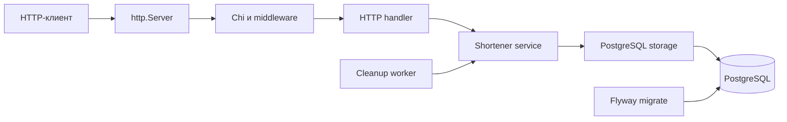
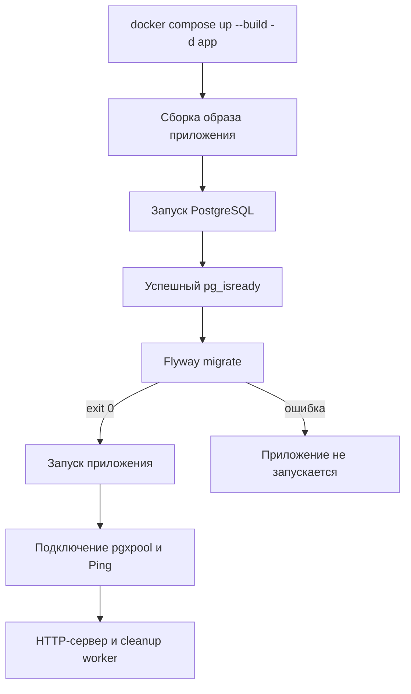
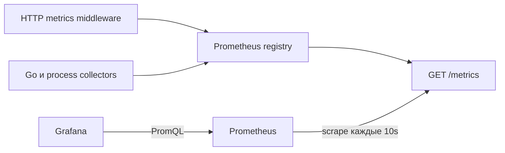

# Как устроен сервис и его запуск

## Компоненты



`cmd/main.go` — точка сборки зависимостей. В нём загружается конфигурация,
создаётся логгер, открывается и проверяется пул PostgreSQL, создаются сервис,
HTTP-handler и сервер. После этого запускаются сервер и worker.

Три прикладных слоя:

1. `internal/handler` разбирает HTTP-запросы, вызывает сервис и формирует ответы.
   Chi выбирает метод обработчика; RequestID, логирование, Recoverer и Timeout
   оборачивают обработку запроса.
2. `internal/services/shortener` определяет правила: допустимые URL и идентификаторы,
   генерация короткого кода, конфликт исходного URL, повтор генерации при коллизии.
   Он обращается к интерфейсу Repository и не импортирует pgx или net/http.
3. `internal/storage/postgres` реализует Repository: SQL, транзакции, блокировки,
   поиск активной ссылки и пакетное удаление.

`internal/domain` содержит Link и ошибки. `internal/worker` задаёт расписание
очистки и вызывает сервис. Flyway работает до приложения и не вызывается Go-кодом.

## Откуда берётся конфигурация

`config.Load` читает YAML через cleanenv, затем cleanenv читает переменные
окружения. Поля развёртывания имеют `yaml:"-"`, поэтому YAML их не задаёт.

- YAML: TTL, таймауты HTTP и параметры очистки.
- Окружение Go-процесса: APP_ENV, HTTP_ADDR, DB_*, SHORTENER_HOST.
- `.env`: локальные значения для подстановок Docker Compose.
- `.env.example`: пример значений, который можно хранить в Git.

Compose читает `.env`, подставляет `${...}` и явно передаёт переменные в контейнеры.
Сам Go-сервис `.env` не открывает. POSTGRES_USER и POSTGRES_PASSWORD используются
для PostgreSQL, Flyway и соответствующих DB_USER и DB_PASSWORD приложения.

Внутри сети Compose БД доступна как `postgres:5432`. На хосте она доступна через
опубликованный POSTGRES_PORT. Аналогично HTTP_ADDR=:8082 — адрес внутри контейнера,
HTTP_PORT — порт хоста, а SHORTENER_HOST — публичный адрес возвращаемых ссылок.
Эти три значения имеют разные назначения.

## Dockerfile

Стадия `build` использует Go той же версии, что указана в go.mod, скачивает зависимости и собирает статический
бинарный файл без CGO. Отдельное копирование go.mod/go.sum позволяет кешировать
загрузку зависимостей при изменении исходников.

Стадия `test` наследует build, добавляет GCC для race detector и SQL-миграции,
затем запускает `go test -race -v -count=1 -timeout=2m ./...`.

Последняя стадия — исполняемый образ Alpine. В ней только бинарный файл, YAML,
CA-сертификаты и непривилегированный пользователь. Исходники, Go-компилятор и
переменные из локального `.env` в исполняемый образ не копируются.

## Что делает docker compose up



Compose создаёт сеть и постоянный том postgres_data. PostgreSQL инициализирует
базу и пользователя только на пустом томе. Изменение пароля в `.env` не меняет
пароль уже созданного пользователя.

Flyway получает SQL-файлы через read-only mount, создаёт flyway_schema_history,
проверяет историю и применяет недостающие миграции. Он завершается после работы.
При следующих изменениях схемы его нужно запускать снова явно.

`depends_on` описывает порядок старта, но не следит за состоянием приложения
постоянно. `/health` сообщает, что HTTP-процесс работает, `/ready` дополнительно
проверяет соединение с PostgreSQL.

## Путь запроса создания ссылки

1. `POST /urls` содержит client_id, external_id и url в JSON.
2. Handler проверяет Content-Type, размер и формат тела.
3. Сервис валидирует значения и генерирует случайный код.
4. Storage открывает транзакцию и берёт advisory lock для пары идентификаторов.
5. Storage читает запись с FOR UPDATE, а затем получает текущее время БД.
6. Если запись активна, возвращает её. Сервис сравнивает исходный URL:
   совпадает — 200 с прежним TTL; отличается — 409.
7. Если записи нет или она истекла, storage сохраняет новую. Истёкшая запись
   заменяется в той же транзакции. Handler возвращает 201.

Блокировка пары нужна даже при отсутствии строки: SELECT FOR UPDATE сам по себе
не заблокирует ещё не существующую запись. Уникальный constraint остаётся
дополнительной гарантией целостности. Коллизия короткого кода откатывает транзакцию,
и сервис генерирует другой код. Ключ дедупликации сейчас не является авторизацией.

## Редирект и TTL

`GET /{code}` проверяет формат кода, затем выполняет поиск с условием
expires_at > clock_timestamp(). Активная ссылка даёт 302 с Location, истёкшая
или отсутствующая — 404. HEAD использует ту же логику без тела ответа.
Cache-Control: no-store препятствует кешированию результата сверх TTL.

Worker раз в cleanup.interval удаляет до cleanup.batch_size истёкших строк.
Очистка имеет собственный timeout; SKIP LOCKED пропускает строки, занятые
другими транзакциями. Задержка очистки влияет на занимаемое место, но не
продлевает доступность ссылки.

После удаления записи сервис забывает пару идентификаторов; её можно использовать
снова, включая другой URL. Это дедупликация в пределах жизни активной ссылки.

## Что проверяют тесты

- Unit: валидацию и ошибки сервиса, повтор генерации кода, HTTP-контракт,
  конфигурацию, отмену worker.
- PostgreSQL integration: реальные SQL и транзакции, параллельное создание,
  отмену ожидания блокировки, откат при коллизии, TTL и пакетную очистку.
- HTTP integration: реальный handler, service и storage в одной цепочке;
  создание, повтор, конфликт, разделение клиентов, редирект, TTL и конкурентные
  запросы с разными URL. HTTP исполняется через httptest без открытия TCP-порта.
- Smoke: настоящий HTTP-процесс в Docker после Flyway, готовность, создание,
  повтор, конфликт, GET/HEAD и конкурентные запросы через TCP.

PostgreSQL integration использует отдельный postgres-test и временную схему
для каждого теста. Все versioned SQL-файлы применяются к этой схеме в порядке
числовых версий. Это тестовый помощник, не замена Flyway: настоящий Flyway
проверяется запуском полного стека и повторным migrate.

## GitHub Actions CI

`.github/workflows/ci.yaml` запускается на pull request, push в main
и вручную через workflow_dispatch. Право токена — только чтение репозитория.

Первый job проверяет gofmt, go vet и тесты с race detector без БД.
В нём PostgreSQL-тесты явно пропускаются.

Второй job выполняется только после успеха первого:

1. Создаёт локальный `.env` из демонстрационного файла.
2. Запускает профиль test с отдельным PostgreSQL и всеми тестами под race detector.
   REQUIRE_INTEGRATION=1 не позволяет молча пропустить интеграционные тесты,
   если TEST_DATABASE_URL забыли передать.
3. Собирает и запускает приложение с основной БД и Flyway на чистом томе runner.
4. Запускает scripts/smoke.py по настоящему HTTP.
5. Повторяет migrate: на уже подготовленной БД миграции не должны применяться снова.
6. Собирает логи, при ошибке сохраняет их как artifact и всегда удаляет
   контейнеры и тома этого временного CI-окружения.

Локально команды те же, но основной том не удаляем без необходимости:

```sh
go test -race ./...
go vet ./...
docker compose --profile test run --build --rm tests
docker compose up --build -d app
python3 scripts/smoke.py
docker compose run --rm flyway migrate
```

GitHub Actions начнёт работать после коммита и push файлов в репозиторий.
Публикация образа и развёртывание на внешнем сервере сейчас не настроены.

## Завершение работы

Docker посылает SIGTERM. Приложение отменяет контекст worker и запускает
http.Server.Shutdown с лимитом 10 секунд: новые соединения прекращаются,
текущим запросам даётся время закончить. Затем приложение ждёт worker и закрывает
пул БД. stop_grace_period=15s оставляет время на это завершение.
`docker compose down` удаляет контейнеры и сеть, но сохраняет postgres_data.

## Мониторинг



`internal/metrics` владеет отдельным registry для каждого приложения. Это
изолирует тесты и не требует глобальной регистрации collectors. `main` создаёт
Metrics и передаёт в handler. Сервис и PostgreSQL-хранилище не зависят от Prometheus.

Middleware метрик оборачивает Recoverer, поэтому видит статус 500 после паники.
Шаблон маршрута читается после вызова следующего обработчика, когда Chi уже выбрал
маршрут. Гистограмма записывает длительность в секундах. Prometheus хранит её
bucket-счётчики, а Grafana рассчитывает p95 через histogram_quantile.

Compose запускает мониторинг после приложения. Prometheus читает конфигурацию
из read-only mount, Grafana — datasource и dashboard provisioning. Переменные
для локальных портов и входа Grafana находятся в `.env`, а настройки scrape
и панели — в `monitoring/`. CI дополнительно проверяет конфиг через promtool.
